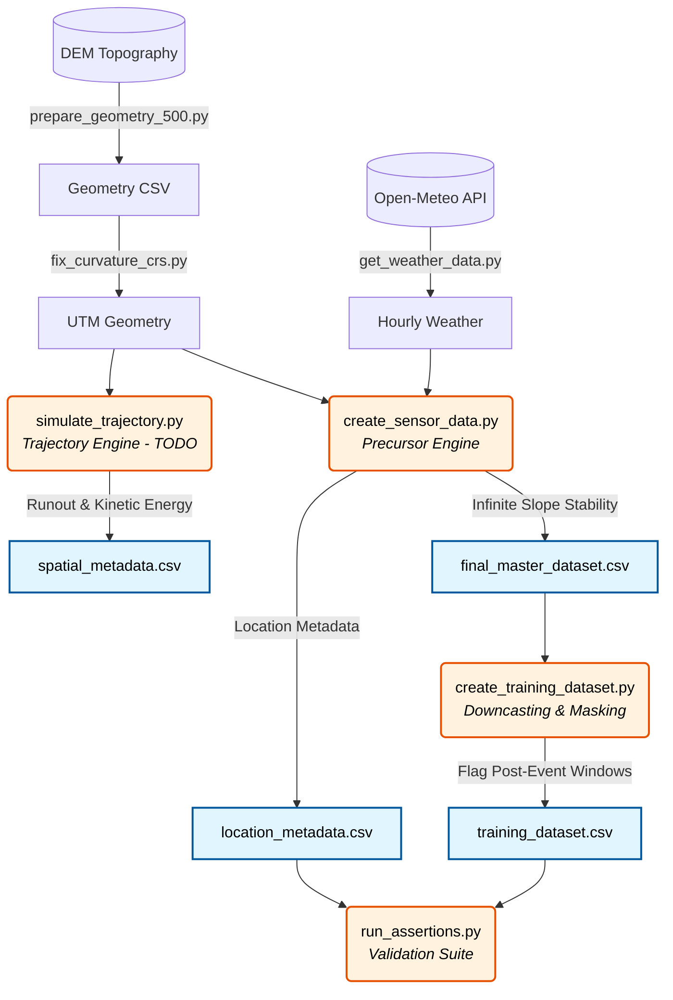

# 🪨 Noamundi Rockfall Simulation Pipeline (Release V1d)


## 📌 1. Project Overview

This repository contains the complete synthetic generation pipeline and physics simulation engines used to create the **Noamundi Rockfall Simulation Dataset (Release V1d)**. The codebase simulates continuous geotechnical stability conditions (via 1D Infinite Slope Stability modeling) and downstream hazard kinematics across **500 monitoring locations** in the Noamundi mining basin in Jharkhand, India, over **3 full years of hourly observations** (2021–2023).

> [!WARNING]
> This codebase generates a *physically grounded synthetic simulation* coupling real-world digital elevation models (DEM) and historical meteorological data with numerical slope stability physics. It is **not** an empirical log of actual mining accidents.

---

## 🛠️ 2. Setup & Installation

Clone the repository and install the verified environment dependencies:

```bash
git clone https://github.com/kaizen105/Rockfall_dataset.git
cd Rockfall_dataset
pip install -r requirements.txt
```

*(Note: Requires raw digital elevation models in `qgis_raw_data/` and pre-processed spatial metadata in `spatial_metadata.csv`).*

---

## ⚙️ 3. Pipeline Architecture & Execution

The dataset is generated through deterministic, reproducible modular scripts located in `src/data/` and validated through assertion suites in `src/analysis/`.

### 3.1 Pipeline Data Flow



### 3.2 Pipeline Steps & Reproduction Commands

To reproduce the multi-seed V1d releases from scratch:

#### Step 1: Spatial & Meteorological Pre-processing
```bash
python src/data/prepare_geometry_500.py
python src/data/fix_curvature_crs.py
python src/data/get_weather_data.py
```

#### Step 2: Main Release Generation (Seed 42 — `data_release_v1d_s1`)
```bash
# 1. Precursor Simulation (chunked 25-location parts with state checkpointing)
python src/data/create_sensor_data.py --output-dir data_release_v1d_s1 --seed 42

# 2. Downcasting to float32/int8 & Clean Training Dataset Creation
python src/data/create_training_dataset.py --input-path data_release_v1d_s1/final_master_dataset.csv --output-path data_release_v1d_s1/training_dataset.csv

# 3. Comprehensive Assertion Suite Execution
python src/analysis/run_assertions.py --release-dir data_release_v1d_s1 --seed 42
```

#### Step 3: Replication Runs (Seeds 1337 & 2024)
```bash
# Replication Run 1 (Seed 1337)
python src/data/create_sensor_data.py --output-dir data_release_v1d_s2 --seed 1337
python src/data/create_training_dataset.py --input-path data_release_v1d_s2/final_master_dataset.csv --output-path data_release_v1d_s2/training_dataset.csv
python src/analysis/run_assertions.py --release-dir data_release_v1d_s2 --seed 1337

# Replication Run 2 (Seed 2024)
python src/data/create_sensor_data.py --output-dir data_release_v1d_s3 --seed 2024
python src/data/create_training_dataset.py --input-path data_release_v1d_s3/final_master_dataset.csv --output-path data_release_v1d_s3/training_dataset.csv
python src/analysis/run_assertions.py --release-dir data_release_v1d_s3 --seed 2024
```

---

## 📊 4. The Output Dataset

Each generated release directory contains:
- **`training_dataset.csv`** (2,113,671,785 bytes):
  The primary ML-ready hourly timeseries containing 18 columns, downcasted to `float32` and `int8`. Preserves all 13,140,000 continuous hours. The 72-hour window following each failure is flagged via `post_event_window = 1` for training/test masking without breaking temporal contiguity.
- **`location_metadata.csv`**:
  Per-location simulation metadata across all 500 locations, containing the random seed, geotechnical traits ($\gamma, z, \phi, c$), pore-pressure lag, dry Factor of Safety ($FS_{\text{dry}}$), calibrated sensitivity $a=0.50$, location hazard weight $w_{\text{loc}}$, event rate $\lambda_{\text{loc}}$, actual event counts, inter-event spacings, and event timestamps.
- **`spatial_metadata.csv`**:
  Static geographical, geomorphological, and geomechanical metadata for all 500 locations, including slope, aspect, roughness, TRI, reprojected planform and profile curvatures, and trajectory runout maximums.
- **`trajectories/`**:
  *(TODO: Kinematic engine trajectory overhaul in progress).*

---

## 🧮 5. Physics Engines Methodology

### 5.1 Precursor Engine (Infinite Slope Stability & Decoupled Hazard)

Factor of Safety ($FS$) is computed hourly:

$$FS_t = \frac{c + (\gamma \cdot z \cdot \cos^2\beta - u_t) \tan\phi}{\gamma \cdot z \cdot \sin\beta \cdot \cos\beta}$$

Where pore pressure is governed by lagged 72-hour precipitation:
$$u_t = \gamma_w \cdot \min\left(1.0, \frac{\text{rain\_72h\_lagged}_t}{100.0}\right) \cdot z$$

#### The V1d Decoupled Architecture
V1d decouples failure timing within a location from failure frequency across locations:
1. **Within-Location Timing**: 80% of events occur during heavy rainfall hours ($R_t \ge 0.50$) with exponential probability weight $w_t \propto \exp(5.0 \cdot R_t)$. The remaining 20% occur uniformly across all hours (stochastic dry triggers). This yields an empirical **Rain Lift of 11.67x** in the $[50, 100)$ mm bin and **30.45x** in the $[100, \infty)$ mm bin (Seed 42).
2. **Cross-Location Frequency**: Location event counts are governed by static geotechnical dry slope stability $FS_{\text{dry}}$:
   $$\lambda_{\text{loc}} = \min\left(15, 5.0 \cdot \frac{w_{\text{loc}}}{\text{mean}(w)}\right), \quad w_{\text{loc}} = \exp(-a \cdot (FS_{\text{dry}} - 1.0))$$
   The hazard parameter $a = 0.50$ was calibrated prior to generation from the $FS_{\text{dry}}$ distribution to produce a 90th-to-10th percentile hazard spread ratio of $3.10$ (target $[3.0, 6.0]$). This ensures a strong negative correlation between stability and event count: **Spearman $r_s = -0.6454$** ($p = 3.01 \times 10^{-60}$).
3. **Precursor Ramp & Zero-Step Leakage**: Every rockfall is preceded by an emergent precursor ramp ($+0.02$ mm/h over $U(6, 48)$ hours) running through `idx_ev` inclusive. Post-event decay starts strictly at `idx_ev + 1`, eliminating step leakage across all events.
4. **Inter-Event Spacing**: Enforces $\ge 120.0$ hours spacing via resampling ($72\text{h post-event decay} + 48\text{h maximum precursor lead time}$). 100% of events are completely isolated.

### 5.2 Trajectory Kinematics Engine
*(TODO: 2D/3D kinematic trajectory updates and calibration in progress).*

---

## 📈 6. Measured Empirical Validation (Summary Table)

All quantities are strictly measured from Release V1d (Seed 42, with Seeds 1337 & 2024 replications confirmed):

| Metric | Main Release (Seed 42) | Replication 1 (Seed 1337) | Replication 2 (Seed 2024) | Target / Assertion |
| :--- | :---: | :---: | :---: | :---: |
| **Total Rows** | 13,140,000 | 13,140,000 | 13,140,000 | 500 locs $\times$ 26,280 hrs |
| **Row Contiguity** | 100% Contiguous | 100% Contiguous | 100% Contiguous | 0 timestamp gaps |
| **Total Events** | 2,484 | 2,567 | 2,529 | ~2,500 target |
| **Rain-Driven Share** | 1,992 (80.19%) | 2,057 (80.13%) | 2,030 (80.27%) | $80\% \pm 10\%$ (Passed) |
| **Random Dry Share** | 492 (19.81%) | 510 (19.87%) | 499 (19.73%) | ~20% (Passed) |
| **Unplaced Events** | 0 (0.00%) | 0 (0.00%) | 0 (0.00%) | 0 unplaced under 120h rule |
| **Events/Loc Mean** | 4.968 | 5.134 | 5.058 | $5.0 \pm 0.5$ (Passed) |
| **Events/Loc Variance** | **7.891** | **8.297** | **8.343** | **$> \text{Mean}$ (Overdispersed, Passed)** |
| **Spearman $r_s$ ($FS_{\text{dry}}$ vs Count)** | **-0.6454** | **-0.6309** | **-0.6369** | $\le -0.40$ (Passed) |
| **Rain Lift: [50, 100) mm** | **11.67x** | **11.76x** | **11.96x** | $\ge 5.0$ (Passed) |
| **Rain Lift: [100, inf) mm** | **30.45x** | **30.96x** | **29.94x** | $\ge 10.0$ (Passed) |
| **Minimum Spacing** | **120.0 hours** | **120.0 hours** | **120.0 hours** | $\ge 120.0$h (Passed) |
| **Isolated Events** | 2,484 (100.0%) | 2,567 (100.0%) | 2,529 (100.0%) | 100.0% (Passed) |
| **Displacement Step Leak** | 0.006428 mm/h | 0.006375 mm/h | 0.006286 mm/h | $\le 3\sigma$ (0.016155 mm/h, Passed) |
| **Vibration Step Leak** | 0.254060 mm/s | 0.234802 mm/s | 0.245452 mm/s | $\le 3\sigma$ (2.016809 mm/s, Passed) |
| **Simultaneous Dropouts** | 1.00076% (131,500 rows) | 1.00076% (131,500 rows) | 1.00076% (131,500 rows) | Exactly 263 rows/loc |

---

## 🔄 7. Changes from V1 (Audit & Architecture Evolution)

1. **Elimination of Target Leakage Windows**:
   - V1 deleted 72h post-event rows from disk, destroying time series contiguity. V1d preserves all 13.14M rows and flags post-event windows via `post_event_window = 1`.
2. **Resolution of Event-Row Discontinuity**:
   - V1 ended precursor ramps at `idx_ev - 1`, producing an artificial downward step at the failure hour. V1d extends ramps through `idx_ev` inclusive.
3. **Enforcement of 120h Minimum Spacing**:
   - V1 allowed 15.7% overlapping events. V1d enforces a 120h minimum spacing constraint, achieving 100% isolated events.
4. **Decoupled Physical Stability**:
   - V1c continuous hazard weighting collapsed rain lift to 1.25x. V1d restored heavy rainfall gating while coupling location frequency to geotechnical stability ($r_s = -0.6454$).
5. **Deterministic Seeding & Resumability**:
   - V1d introduces chunked part writes (25 locations per file) with serialised RNG states for atomic resumability and multi-seed replication.

---

## 🧪 8. FS With vs. Without: Benchmark Results

*(Placeholder: Out-of-fold PR-AUC results comparing Rain-Only vs. Rain-Only + FS under 5-fold StratifiedGroupKFold cross-validation will be recorded here following execution of the preregistered evaluation ladder).*

---

## ⚠️ 9. Known Limitations

1. **FS Absolute Calibration**: The 1D Infinite Slope Factor of Safety is a relative stability index (median $FS \approx 3.0$), not an absolute failure threshold.
2. **Simulated Ground Truth**: Labels and sensor channels emerge from a known mathematical generating process, not in-situ field telemetry.
3. **Subtle Precursor Amplitude**: Displacement precursors are calibrated to realistic, subtle magnitudes (+0.02 mm/h ramp) rather than synthetic spikes.
4. **Vibration Noise Modeling in V1d**: In V1d, sensor measurement noise $\mathcal{N}(0, 0.2)$ and zero-clipping were omitted on `Vibration_mm_s`, leaving values strictly positive ($\ge 0.10$ mm/s) without zero-inflation.
5. **Hazard Calibration Choices**: The hazard sensitivity $a = 0.50$ and the $[3.0, 6.0]$ inter-decile spread target are engineering design choices.
6. **Geotechnical Parameter Sources**: Cohesion ($c$) and friction angle ($\phi$) ranges reflect typical literature values for open-pit slopes (Hoek & Bray), not laboratory core tests from Noamundi.
7. **Trajectory Kinematics Engine**: Kinematics use mass-independent point-mass Euler integration; the resulting 4.00x and 20.00x kinetic energy scaling across boulder masses is mathematically guaranteed by construction and should not be cited as empirical validation.

---

## 💻 10. Dataset & Resources

- **Hugging Face Dataset**: [Kaizen696/noamundi-rockfall-simulation-dataset](https://huggingface.co/datasets/Kaizen696/noamundi-rockfall-simulation-dataset)
- **Terrain Data**: NASA SRTM GL1 30m via OpenTopography
- **Weather Data**: Historical hourly records via Open-Meteo Historical Archive API
